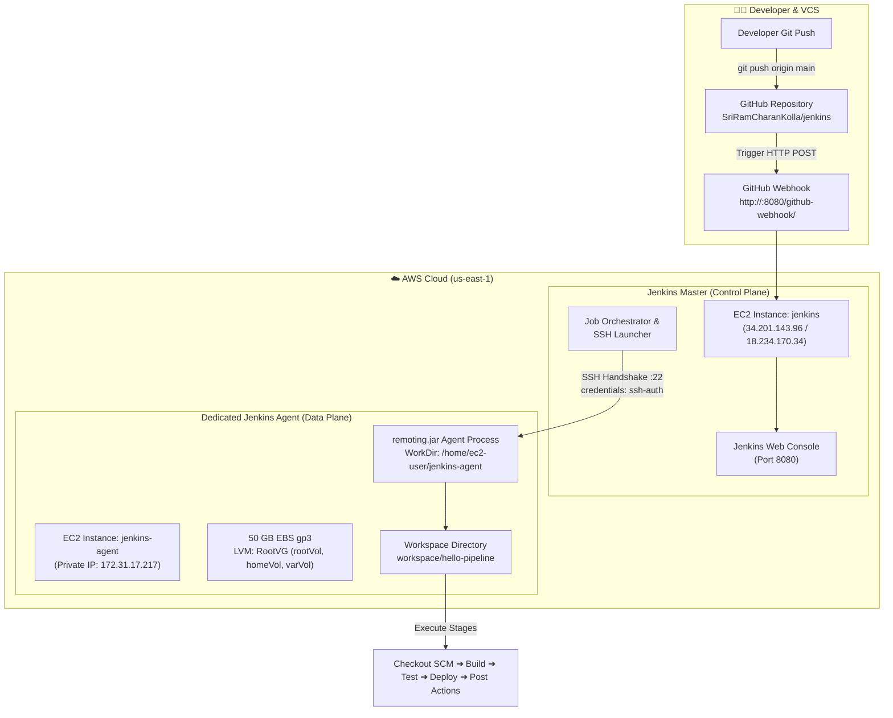
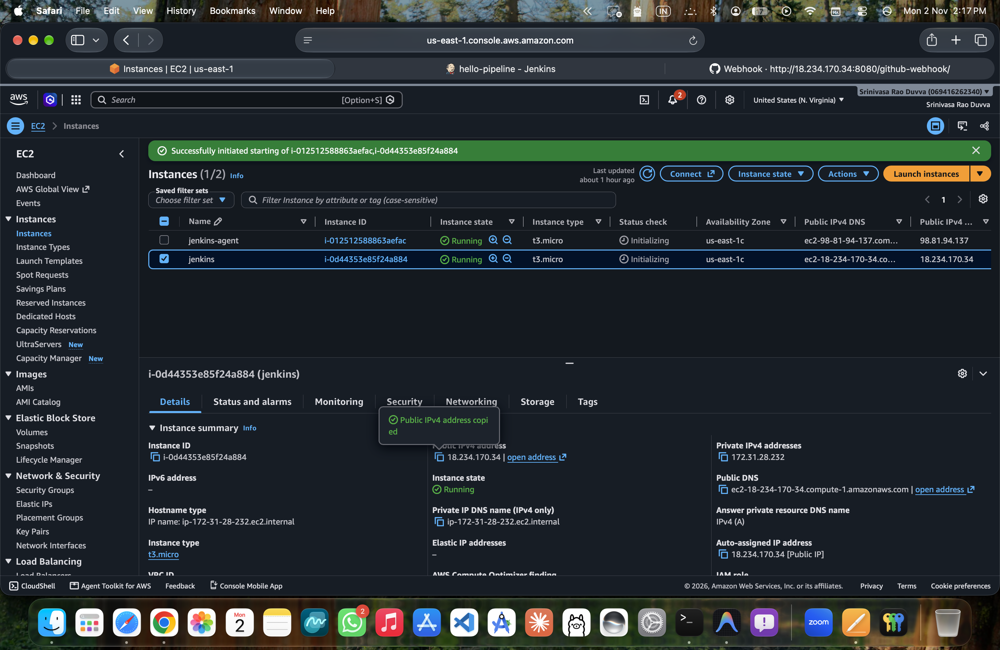
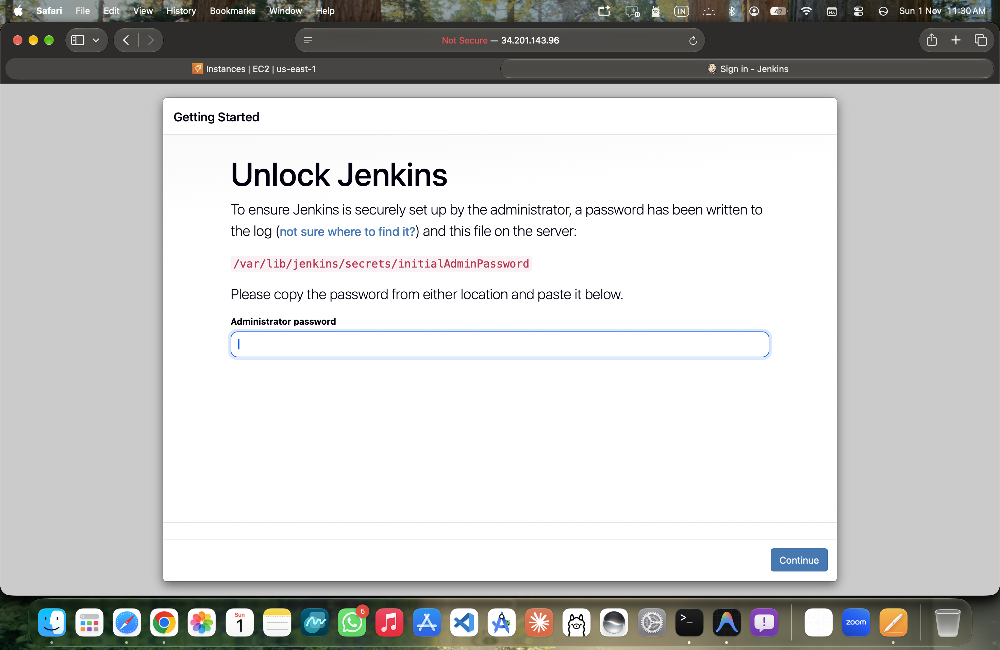
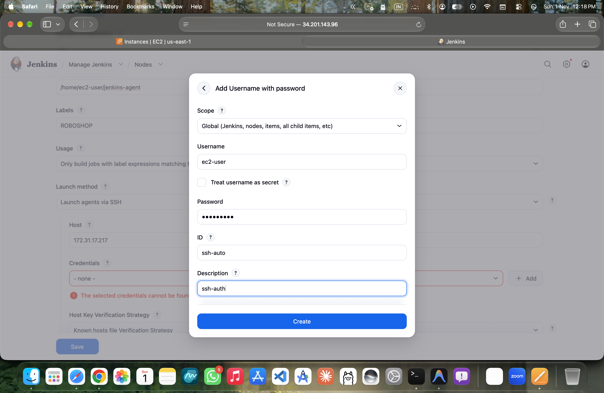
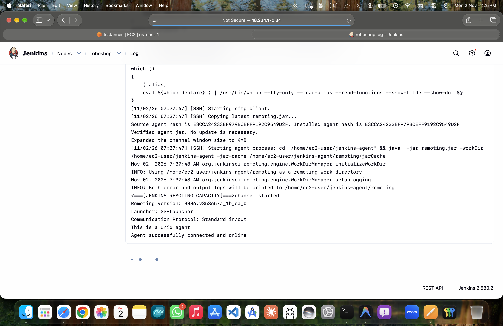
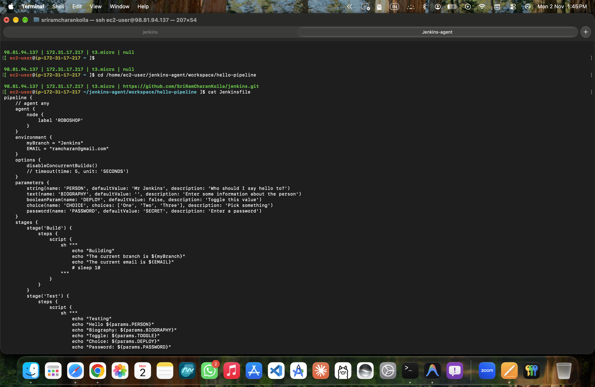
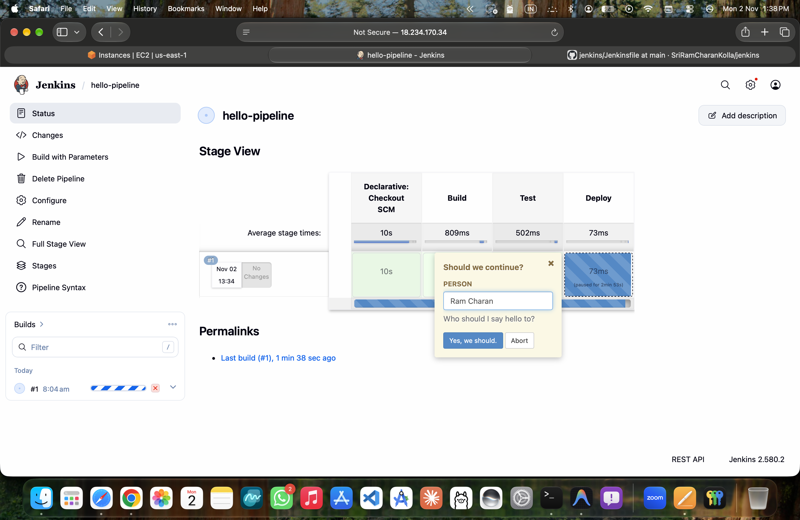
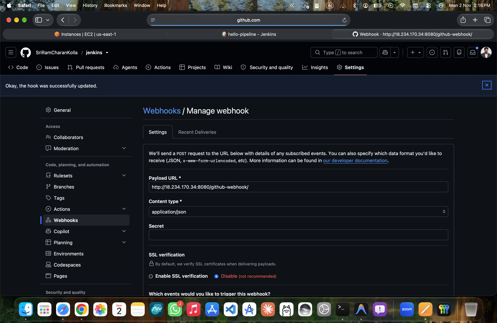
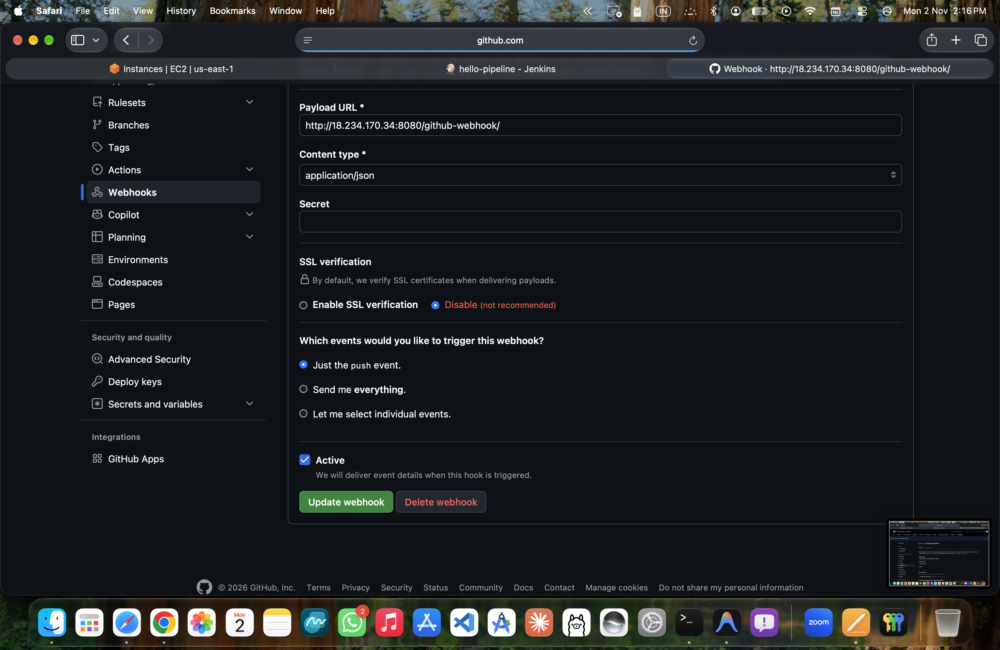
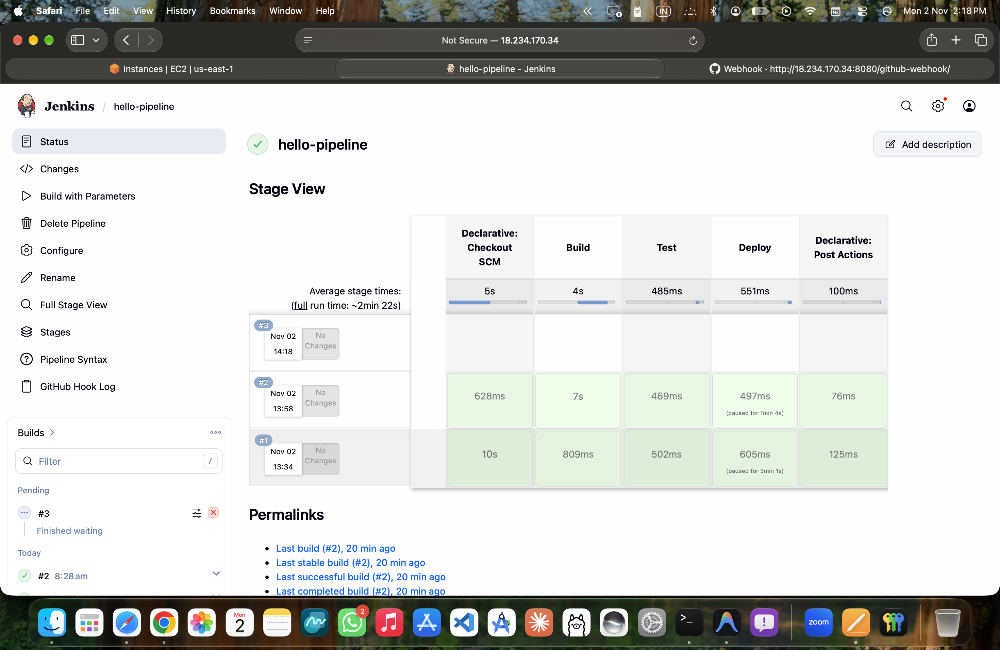

# Enterprise Jenkins CI/CD Distributed Architecture & Pipeline Platform

Production-grade Jenkins CI/CD ecosystem demonstrating **Distributed Master-Agent Architecture**, **Declarative Pipeline-as-Code**, **Automated GitHub Webhooks**, **Interactive Approval Gates**, and **Linux LVM Storage Management** on AWS.

---

## 🏛️ System Architecture



---

## 🚀 Key Engineering Highlights

- **Distributed Master-Agent Architecture**: Decoupled control plane from build execution. The master schedules jobs, manages credentials, and coordinates events; the dedicated agent (`roboshop`) executes heavy compiler, test, and container tasks in isolation.
- **Automated Continuous Integration**: Instantaneous build execution triggered via GitHub push webhooks (`/github-webhook/`).
- **Pipeline-as-Code (Declarative)**: Version-controlled [`Jenkinsfile`](Jenkinsfile) featuring multi-type parameters, environment variables, concurrency locks, and conditional stage execution (`when`).
- **Enterprise Governance**: Built-in human approval gate (`input`) for production deployment authorization.
- **Production Storage Management**: AWS EBS root volume expansion to 50 GB using Linux Logical Volume Manager (`lvextend` + `xfs_growfs`) to support scalable build workspaces.

---

## 📸 Hands-On Proof of Work (Recruiter Showcase)

### 1. AWS Cloud Infrastructure: Dedicated Master & Agent Instances

To ensure stability, reliability, and security, the environment is architected using dedicated Amazon EC2 instances running Red Hat Enterprise Linux 9:
- **`jenkins` (Master)**: Hosts the Jenkins controller, Web UI, plugin registry, and scheduling engine.
- **`jenkins-agent` (Worker)**: Isolated build node running in the private subnet with high-capacity storage.



---

### 2. Jenkins Enterprise Setup & Initial Administrator Authentication

Initial setup of the Jenkins controller on Amazon EC2, verifying the one-time bootstrap token generated at `/var/lib/jenkins/secrets/initialAdminPassword` before initializing role-based access control.

> 📘 *For comprehensive troubleshooting, password hash recovery, and security bypass root-cause analysis, refer to [learning.md](learning.md#5-method-1-direct-bcrypt-hash-injection-fastest--recommended).*



---

### 3. Distributed Master-Agent Node Configuration

Configured a permanent worker node named **`roboshop`** inside Jenkins with the following enterprise parameters:
- **Remote Root Directory**: `/home/ec2-user/jenkins-agent`
- **Labels**: `ROBOSHOP` (Allows targeted workload binding via `agent { label 'ROBOSHOP' }`)
- **Usage**: *Only build jobs with label expressions matching this node* (Strict isolation)
- **Launch Method**: *Launch agents via SSH* connecting to private IP `172.31.17.217` using Jenkins stored credential `ssh-auth`



---

### 4. SSH Remoting Handshake & Agent Daemon Initialization

Live daemon logs proving successful bi-directional communication between the Jenkins Controller and the remote Linux Agent:
1. Master initiates SSH transport over port 22 and verifies host authenticity.
2. SFTP copies and validates the latest `remoting.jar` daemon (`SHA-256` hash verification).
3. The channel is established with a 4MB window size, bringing the `roboshop` agent online and ready to execute builds.



---

### 5. Agent Workspace Inspection & Linux LVM Disk Management

Inspecting the live build environment directly on the agent node:
- **Workspace Directory**: `/home/ec2-user/jenkins-agent/workspace/hello-pipeline`
- **Source Code Checkout**: Automatic Git synchronization of [`Jenkinsfile`](Jenkinsfile).
- **LVM Disk Resizing**: Resized the agent storage to 50 GB using `lvextend` across `/dev/mapper/RootVG-rootVol`, `/dev/mapper/RootVG-homeVol`, and `/dev/mapper/RootVG-varVol`, followed by online filesystem growth via `xfs_growfs`.



---

### 6. Declarative Pipeline Execution & Interactive Approval Gates

Execution of the multi-stage declarative pipeline defined in [`Jenkinsfile`](Jenkinsfile):
- **Stage 1: Declarative Checkout SCM**: Pulls the latest commit from GitHub.
- **Stage 2: Build**: Reads environment variables (`myBranch`, `EMAIL`) and displays build context.
- **Stage 3: Test**: Evaluates parameterized inputs (`PERSON`, `BIOGRAPHY`, `DEPLOY`, `PASSWORD`).
- **Interactive Input Gate**: Pauses deployment and prompts the operator: `"Should we continue? (PERSON: Ram Charan)"` before promoting to production.



---

### 7. Automated CI/CD: GitHub Webhook Integration

Configured GitHub repository webhooks to automate pipeline triggers on every `git push`:
- **Payload URL**: `http://<JENKINS_MASTER_IP>:8080/github-webhook/`
- **Content Type**: `application/json`
- **Event Type**: *Just the push event*
- **Status**: Verified delivery with active green status check.




---

### 8. End-to-End Delivery & Execution History

Continuous integration build history showing sequential pipeline runs (#1, #2, #3):
- Stage metrics, execution timestamps, and build stability across all stages.
- Post-action handling (`always`, `success`, `failure`, `unstable`) ensuring full observability and notifications.



---

## 🛠️ Repository File Structure

```text
.
├── Jenkinsfile                  # Full Declarative Pipeline with Parameters, Stages & Post-Actions
├── Jenkinsfile.dcl              # Baseline Declarative Template
├── README.md                    # Project Documentation & Recruiter Showcase (This file)
├── learning.md                  # Comprehensive Troubleshooting, RCA & Password Recovery Guide
└── images/
    └── proof-of-work/           # Verified Hands-On Screenshots
        ├── 01-aws-ec2-jenkins-master-and-agent.png
        ├── 02-jenkins-initial-unlock-setup.png
        ├── 03-jenkins-node-agent-configuration.png
        ├── 04-jenkins-agent-ssh-remoting-connected.png
        ├── 05-agent-workspace-terminal-inspection.png
        ├── 06-pipeline-stage-view-interactive-approval.png
        ├── 07-github-webhook-payload-configuration.png
        ├── 08-github-active-webhooks-management.png
        └── 09-automated-pipeline-execution-history.png
```

---

## 💼 Technical Competencies Demonstrated

| Skill Area | Practical Implementation in this Project |
| :--- | :--- |
| **CI/CD Architecture** | Implemented Distributed Master-Agent clustering with SSH remoting, preventing controller starvation. |
| **Pipeline-as-Code** | Authored multi-stage Declarative Pipelines with input approval gates, environment scopes, and post-build conditions. |
| **Automation & Triggers** | Integrated GitHub Webhooks for instantaneous event-driven build execution and scheduled Cron triggers (`* * * * *`). |
| **Linux & Cloud Systems** | Managed Red Hat Enterprise Linux instances on AWS EC2, configured LVM volumes (`lvextend`), and resized XFS filesystems (`xfs_growfs`). |
| **Troubleshooting & RCA** | Performed root-cause analyses on Jenkins disk threshold alerts, Linux subshell behaviors (`sudo cd`), and XML credential hash injection (`#jbcrypt:`). |

---

## 🔗 Links & Deep Dives
- [Pipeline Source Code (`Jenkinsfile`)](Jenkinsfile)
- [Comprehensive Learning & Troubleshooting Guide (`learning.md`)](learning.md)
