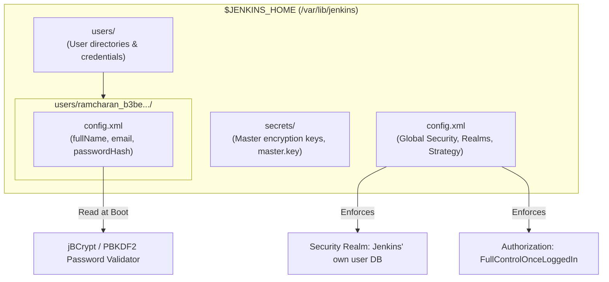
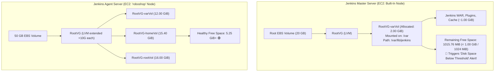

# Jenkins Administration, Authentication & Password Recovery Troubleshooting Guide

Comprehensive operational guide and root-cause analysis (RCA) for Jenkins user authentication, credential recovery, configuration internals, and Linux system debugging.

---

## 📑 Table of Contents
1. [Jenkins Internal Authentication & Credential Architecture](#1-jenkins-internal-authentication--credential-architecture)
2. [Incident RCA 1: The `initialAdminPassword` Missing File Mystery](#2-incident-rca-1-the-initialadminpassword-missing-file-mystery)
3. [Incident RCA 2: The Linux Subshell Trap (`sudo cd`)](#3-incident-rca-2-the-linux-subshell-trap-sudo-cd)
4. [Incident RCA 3: Why Disabling Security Still Prompts for Login](#4-incident-rca-3-why-disabling-security-still-prompts-for-login)
5. [Method 1: Direct Bcrypt Hash Injection (Fastest & Recommended)](#5-method-1-direct-bcrypt-hash-injection-fastest--recommended)
6. [Method 2: Full Security Bypass via `config.xml` (UI Reset)](#6-method-2-full-security-bypass-via-configxml-ui-reset)
7. [Post-Recovery Hardening & Security Best Practices](#7-post-recovery-hardening--security-best-practices)
8. [Troubleshooting & Quick Reference Matrix](#8-troubleshooting--quick-reference-matrix)
9. [Deep Dive: Jenkins Node Disk Management, LVM Layout & "Below Threshold" Alert](#9-deep-dive-jenkins-node-disk-management-lvm-layout--below-threshold-alert)

---

## 1. Jenkins Internal Authentication & Credential Architecture

Jenkins manages user identity, permissions, and credentials via XML configuration files stored under `$JENKINS_HOME` (typically `/var/lib/jenkins` on RHEL/CentOS/Ubuntu).



### Key Files and Directories:
- **Global Config**: `/var/lib/jenkins/config.xml` — Controls whether security is enabled (`<useSecurity>`), which Security Realm manages users (`<securityRealm>`), and how authorizations are evaluated (`<authorizationStrategy>`).
- **User Database**: `/var/lib/jenkins/users/` — Each user created via the web UI receives a dedicated subdirectory formatted as `<username>_<unique-hash-id>/`.
- **User Specific Config**: `/var/lib/jenkins/users/<username>_<id>/config.xml` — Stores the individual user's profile metadata, API tokens, and cryptographic password hash:
  ```xml
  <passwordHash>#jbcrypt:$2a$10$DdaWzN64JgUtLdvxWIflcuQu2fgrrMSAMUqZfZDc4WuDpSlOGJtPC</passwordHash>
  ```
- **Cryptographic Scheme**: Modern Jenkins uses **jBCrypt** (indicated by the `#jbcrypt:` prefix) with salt factor 10, preventing plaintext storage and resisting rainbow table lookups.

---

## 2. Incident RCA 1: The `initialAdminPassword` Missing File Mystery

### Symptom:
```bash
[ ec2-user@ip-172-31-16-239 ~ ]$ sudo cat /var/lib/jenkins/secrets/initialAdminPassword
cat: /var/lib/jenkins/secrets/initialAdminPassword: No such file or directory
```

### Root Cause Analysis (RCA):
1. **One-Time Bootstrap Token**: `/var/lib/jenkins/secrets/initialAdminPassword` is created **only once** upon the initial startup of a freshly installed Jenkins instance.
2. **Post-Wizard Self-Destruction**: When an administrator opens the Jenkins Web UI for the first time, completes the "Getting Started" wizard, and creates the first admin user (`ramcharan`), Jenkins triggers internal cleanup logic.
3. **Security Safeguard**: To prevent unauthorized users with local file read permissions from stealing the initial admin secret, Jenkins **permanently deletes** `initialAdminPassword`.
4. **Key Takeaway**: After the initial setup wizard is finished, attempting to read `initialAdminPassword` will **always** fail with `No such file or directory`.

---

## 3. Incident RCA 2: The Linux Subshell Trap (`sudo cd`)

### Symptom:
```bash
[ ec2-user@ip-172-31-16-239 ~ ]$ sudo cd /var/lib/jenkins/users/ramcharan_b3be412f4949fce48790292a3ce2ceba765548f8e9a4de1f9e8208d5866ac6d3
[ ec2-user@ip-172-31-16-239 ~ ]$ ls -l
# (Still in /home/ec2-user, directory did not change!)
```

### Root Cause Analysis (RCA):
1. **Built-in vs. Executable Binary**: In Linux shells (`bash`, `zsh`), `cd` (Change Directory) is not an executable binary located in `/bin` or `/usr/bin`. It is a **shell built-in command** that alters the state of the *current running shell process*.
2. **Subshell Execution under `sudo`**: `sudo` requires an external executable. When running `sudo cd <path>`, the operating system spawns an ephemeral root subshell, executes `cd` inside that subshell, and immediately exits.
3. **Parent Process Isolation**: The parent shell (your active terminal session as `ec2-user`) never changed directories.

### Proper Solutions:
- **Solution A: Switch to interactive root shell**:
  ```bash
  sudo -i
  cd /var/lib/jenkins/users/ramcharan_*
  ```
- **Solution B: Execute subshell with commands chained**:
  ```bash
  sudo bash -c "cd /var/lib/jenkins/users/ramcharan_* && ls -la"
  ```
- **Solution C: Direct path targeting (Recommended)**:
  ```bash
  sudo ls -la /var/lib/jenkins/users/ramcharan_*/
  ```

---

## 4. Incident RCA 3: Why Disabling Security Still Prompts for Login

### Symptom:
Even after setting `<useSecurity>false</useSecurity>` in `/var/lib/jenkins/config.xml` and restarting Jenkins, Safari/Chrome continues to display the **"Sign in to Jenkins"** login page:


### Root Cause Analysis (RCA):
In modern Jenkins (2.x / 3.x), the security model is governed by two separate parameters that must both be aligned:
1. **`<useSecurity>`**: Toggles the security engine.
2. **`<authorizationStrategy>`**: Dictates whether unauthenticated (anonymous) visitors are allowed read or write access.

If your `/var/lib/jenkins/config.xml` retains the following block:
```xml
<authorizationStrategy class="hudson.security.FullControlOnceLoggedInAuthorizationStrategy">
  <denyAnonymousReadAccess>true</denyAnonymousReadAccess>
</authorizationStrategy>
```
The `<denyAnonymousReadAccess>true</denyAnonymousReadAccess>` rule strictly intercepts every anonymous request. When a user navigates to `http://<ip>:8080/`, Jenkins' security filter intercepts the unauthenticated session and immediately forces an HTTP 302 redirect to `/login`, regardless of `<useSecurity>false</useSecurity>`.

---

## 5. Method 1: Direct Bcrypt Hash Injection (Fastest & Recommended)

This method does **not** disable security, does not require tampering with authorization strategies, and immediately resets the password of user `ramcharan` to a known string (`admin`).

### Step-by-Step Execution:

#### 1. Navigate to the User Directory:
```bash
cd /var/lib/jenkins/users/ramcharan_*
```

#### 2. Inspect Existing Password Hash:
```bash
sudo grep -n "passwordHash" config.xml
```

#### 3. Inject the Universal Bcrypt Hash for `admin`:
The standard Jenkins jBCrypt hash for plaintext password `admin` is:
`#jbcrypt:$2a$10$DdaWzN64JgUtLdvxWIflcuQu2fgrrMSAMUqZfZDc4WuDpSlOGJtPC`

Execute the inline replacement:
```bash
sudo sed -i 's|<passwordHash>.*</passwordHash>|<passwordHash>#jbcrypt:$2a$10$DdaWzN64JgUtLdvxWIflcuQu2fgrrMSAMUqZfZDc4WuDpSlOGJtPC</passwordHash>|' config.xml
```

#### 4. Restore the Original `/var/lib/jenkins/config.xml` (if modified):
```bash
sudo cp /var/lib/jenkins/config.xml.bak /var/lib/jenkins/config.xml
```

#### 5. Restart Jenkins Service:
```bash
sudo systemctl restart jenkins
```

#### 6. Log In:
- **URL**: `http://<your-jenkins-ip>:8080`
- **Username**: `ramcharan`
- **Password**: `admin`

---

## 6. Method 2: Full Security Bypass via `config.xml` (UI Reset)

If you do not know the username or have multiple corrupt user records, you must completely disable both the Security Realm and Authorization Strategy.

### Step-by-Step Execution:

#### 1. Create a Safety Backup:
```bash
sudo cp /var/lib/jenkins/config.xml /var/lib/jenkins/config.xml.bak_$(date +%F)
```

#### 2. Edit `/var/lib/jenkins/config.xml`:
Open the configuration file:
```bash
sudo vi /var/lib/jenkins/config.xml
```

Modify the following three tags:
```xml
<!-- 1. Disable security flag -->
<useSecurity>false</useSecurity>

<!-- 2. Set authorization strategy to Unsecured -->
<authorizationStrategy class="hudson.security.AuthorizationStrategy$Unsecured"/>

<!-- 3. Set security realm to None -->
<securityRealm class="hudson.security.SecurityRealm$None"/>
```

#### 3. Restart Jenkins:
```bash
sudo systemctl restart jenkins
```

#### 4. Access UI & Reset Credentials:
1. Open `http://<your-jenkins-ip>:8080` (Bypasses login completely; lands directly on dashboard).
2. Navigate to **Manage Jenkins** $\rightarrow$ **Users**.
3. Click the user (`ramcharan`) $\rightarrow$ Click **Configure**.
4. Set a new password and click **Save**.

#### 5. Re-enable Security via UI:
1. Navigate to **Manage Jenkins** $\rightarrow$ **Security**.
2. Check **Enable security**.
3. **Security Realm**: Select `Jenkins' own user database`.
4. **Authorization**: Select `Logged-in users can do anything`.
5. Click **Save**.

---

## 7. Post-Recovery Hardening & Security Best Practices

### A. Updating User Password to a Strong String:
Never leave the default `admin` password active on an internet-facing EC2 instance.
1. Log in to Jenkins.
2. Click **ramcharan** (top-right corner) $\rightarrow$ **Configure**.
3. Update to an enterprise passphrase (e.g. `DevOps321#Secure` or `RoboShop#123`).
4. Click **Save**.

### B. Securing Port 8080 at Security Group Level:
Ensure your AWS Security Group restricts port `8080` to your specific public IP rather than `0.0.0.0/0`:
```bash
# Get your current public IP:
curl -s https://checkip.amazonaws.com

# Authorize inbound rule only for your IP /32 in AWS CLI:
aws ec2 authorize-security-group-ingress \
  --group-id <JENKINS_SG_ID> \
  --protocol tcp \
  --port 8080 \
  --cidr <YOUR_PUBLIC_IP>/32
```

### C. Creating an Emergency Secondary Administrator:
Always keep a backup administrative account to prevent lockout:
1. Go to **Manage Jenkins** $\rightarrow$ **Users** $\rightarrow$ **Create User**.
2. Username: `backup-admin`.
3. Store the credentials securely in AWS Secrets Manager or a password vault.

---

## 8. Troubleshooting & Quick Reference Matrix

| Issue / Error | Root Cause | Immediate Fix |
| :--- | :--- | :--- |
| `cat: /var/lib/jenkins/secrets/initialAdminPassword: No such file` | File automatically deleted by Jenkins after setup wizard finishes. | Normal behavior. Use [Method 1](#5-method-1-direct-bcrypt-hash-injection-fastest--recommended) to reset password. |
| `cat: /var/lib/jenkins/users/...: Is a directory` | User directories hold internal configurations (`config.xml`), not plaintext strings. | Target the internal file: `sudo cat /var/lib/jenkins/users/<user>_*/config.xml`. |
| `sudo cd` does not change directory | `cd` is a shell built-in; `sudo` executes in a detached subshell. | Use `sudo -i` to become root, or reference paths directly. |
| `<useSecurity>false</useSecurity>` still redirects to `/login` | `<denyAnonymousReadAccess>true</denyAnonymousReadAccess>` blocks anonymous visitors. | Set `<authorizationStrategy class="hudson.security.AuthorizationStrategy$Unsecured"/>` or use Bcrypt hash injection. |
| User password hash fails to load | Hash missing `#jbcrypt:` prefix or invalid salt length. | Ensure the replacement begins with `#jbcrypt:$2a$10$...`. |
| Jenkins fails to start (`Job for jenkins.service failed`) | XML syntax error or unclosed tag in `/var/lib/jenkins/config.xml`. | Restore backup: `sudo cp /var/lib/jenkins/config.xml.bak /var/lib/jenkins/config.xml` and restart. |
| `Built-In Node Free Disk Space is below threshold (1.00 GiB)` | `/var/lib/jenkins` resides on `/varVol` (2GB default LVM) on Jenkins Master; plugins filled ~1GB. Resizing was done on Agent, not Master. | Extend `/varVol` on Master (`lvextend -L +10G` & `xfs_growfs /var`) or adjust threshold in `Configure Monitors`. |

---

## 9. Deep Dive: Jenkins Node Disk Management, LVM Layout & "Below Threshold" Alert

### A. Symptom & Visual Evidence:
In Jenkins Web UI $\rightarrow$ **Manage Jenkins** $\rightarrow$ **Nodes**:
- **Built-In Node**: Marked with a red status icon $\otimes$.
- **Alert Message**: `Disk space is below threshold of 1.00 GiB. Only 1015.76 MiB out of 1.94 GiB left on /var/lib/jenkins.`
- **roboshop Agent Node**: Healthy (showing `5.25 GiB` free disk space).

### B. Root Cause Analysis (RCA): Why Did This Happen?



#### 1. Master vs. Agent Confusion:
- You provisioned a 50 GB disk, configured partitions, and successfully executed `lvextend` + `xfs_growfs` on **`ip-172-31-17-217`** (the **Jenkins Agent** EC2 instance).
- Notice on the Jenkins **Nodes** page: the **`roboshop`** agent shows `5.25 GiB` free disk space and is completely healthy!
- The warning is on **`Built-In Node`**, which is the **Jenkins Master EC2 instance** (`ip-172-31-16-239` / `34.201.143.96`), a completely separate server.

#### 2. Why Did Master Disk Fill Up Without Any Pipelines Created?
In the `Redhat-9-DevOps-Practice` AMI, the disk uses LVM (`RootVG`) with conservative default logical volume sizes:
- `/dev/mapper/RootVG-rootVol` $\rightarrow$ 6.00 GiB
- `/dev/mapper/RootVG-homeVol` $\rightarrow$ 5.40 GiB
- `/dev/mapper/RootVG-varVol` $\rightarrow$ **2.00 GiB** (Mounted at `/var`)

When you install Jenkins on the Master:
- Jenkins installs to `/var/lib/jenkins`.
- The Jenkins core binary, unpacked WAR files, default plugins (Pipeline, Git, SSH Agent, Folders, etc.), and initial logs occupy **~1.00 GiB**.
- Calculation: $\text{Total Volume (1.94 GiB)} - \text{Jenkins Footprint (~0.95 GiB)} = \mathbf{1015.76\text{ MiB}}$.
- Jenkins built-in disk space monitor enforces a hardcoded threshold of **`1.00 GiB` (1024 MiB)**.
- Since $1015.76\text{ MiB} < 1024\text{ MiB}$, Jenkins flags the Built-In Node as disk-constrained!

---

### C. Resolution 1: Extend `/varVol` on the Jenkins Master Server (Recommended)

SSH into your **Jenkins Master server** (e.g., `ssh ec2-user@<jenkins-master-ip>`) and run:

```bash
# 1. Switch to root
sudo su -

# 2. Check Volume Group available space
vgs

# 3. Extend the /var logical volume by 5 GB or 10 GB (RootVG has free unallocated extents)
lvextend -L +5G /dev/mapper/RootVG-varVol

# 4. Grow the XFS filesystem on /var online (without downtime)
xfs_growfs /var

# 5. Verify new disk size (will show ~7 GiB total, >5 GiB free)
df -hT /var
```

Once resized, refresh the Jenkins Nodes page or click **Configure Monitors** $\rightarrow$ refresh data. The red warning on Built-In Node will immediately vanish.

---

### D. Resolution 2: Adjust Jenkins Disk Space Monitor Threshold via UI

If you do not want to alter the Master disk right now:
1. Open Jenkins Web UI $\rightarrow$ **Manage Jenkins** $\rightarrow$ **Nodes**.
2. In the top-right corner, click **Configure Monitors** (as seen in your screenshot).
3. Find **Free Disk Space** monitor.
4. Change the threshold value from `1.00 GiB` to `500MiB` (or uncheck the monitor to disable warnings).
5. Click **Save**.

---

### E. Enterprise Best Practice: Disable Job Execution on Master

In enterprise DevSecOps pipelines:
- The **Jenkins Master (Built-In Node)** should **NEVER execute build jobs**. Its role is strictly to act as the orchestrator, scheduler, and UI controller.
- All actual builds must run exclusively on agent nodes (`roboshop`).
- **Configuration**:
  1. Go to **Manage Jenkins** $\rightarrow$ **Nodes** $\rightarrow$ **Built-In Node** $\rightarrow$ **Configure** (gear icon).
  2. Set **# of executors** to `0`.
  3. Click **Save**.
  This guarantees that even if the Master has limited disk space, no workspace or artifact will ever be written to the Master server.

---

### F. Key Engineering Insight: Why the Alert Does NOT Block Pipelines

> [!IMPORTANT]
> **Core Architectural Takeaway (Ram Charan's Operational Insight):**
>
> **The "Free Disk Space is below threshold" alert on the Built-In Node is an operational health notification — it does NOT halt or fail Jenkins pipeline execution.**

#### Why Pipelines Continue to Run Smoothly:
1. **Agent-Centric Execution**: In production pipelines, jobs specify `agent { label 'ROBOSHOP' }`. Jenkins delegates the execution entirely to the `roboshop` agent node (`ip-172-31-17-217`), which has ample disk capacity (50 GB EBS with extended LVM volumes).
2. **Control Plane vs. Data Plane Separation**:
   - **Control Plane (Master / Built-In Node)**: Parses the `Jenkinsfile`, renders the UI, and coordinates scheduling. It only stores tiny build metadata XMLs and console logs.
   - **Data Plane (Agent / `roboshop` Node)**: Performs heavy workspace operations (`git checkout`, dependencies download, Docker builds, artifact creation).
3. **When Would It Actually Block?**:
   - The alert only transitions into a hard blocker if:
     - A job is explicitly configured to run on the `Built-In Node` (which is why setting executors to `0` is recommended).
     - The master server reaches absolute 100% disk exhaustion (`0 MiB` free), causing OS I/O writes to fail.
   - At `1015.76 MiB`, the master operates completely normally.

---

### G. Quick Summary Table: Issue, Root Cause, Solution & Understanding

| Component | Technical Detail |
| :--- | :--- |
| **Issue** | Jenkins Web UI flags `Built-In Node` with red status: `Disk space is below threshold of 1.00 GiB. Only 1015.76 MiB out of 1.94 GiB left on /var/lib/jenkins`. |
| **Root Cause** | The `Redhat-9-DevOps-Practice` AMI assigns only 2.00 GiB to `/var` (`RootVG-varVol`). Jenkins installation binaries and default plugins consume ~1.00 GiB, leaving 1015.76 MiB, which is below Jenkins' default threshold of 1.00 GiB (1024 MiB). |
| **Common Confusion** | LVM resize (`lvextend` + `xfs_growfs`) was executed on the **Agent instance** (`172.31.17.217`), but the alert belongs to the **Master instance** (`172.31.16.239`). |
| **Permanent Solution** | SSH into Jenkins Master $\rightarrow$ `sudo su -` $\rightarrow$ `lvextend -L +5G /dev/mapper/RootVG-varVol` $\rightarrow$ `xfs_growfs /var`. |
| **UI Quick Solution** | `Manage Jenkins` $\rightarrow$ `Nodes` $\rightarrow$ `Configure Monitors` $\rightarrow$ Set Free Disk Space threshold to `500MiB` or uncheck. |
| **Core Understanding** | This is a non-blocking warning. Pipelines routed to the `ROBOSHOP` agent are unaffected because builds run isolated on the agent's 50 GB storage. |

---

## 🔗 Related Repository Files
- [Jenkinsfile](file:///Users/sriramcharankolla/Desktop/DevOps/jenkins/Jenkinsfile): Pipeline automation definition for CI/CD test and deployment stages.
- [Jenkinsfile.dcl](file:///Users/sriramcharankolla/Desktop/DevOps/jenkins/Jenkinsfile.dcl): Declarative pipeline structure reference.
- [README.md](file:///Users/sriramcharankolla/Desktop/DevOps/jenkins/README.md): Repository entry point.
- [learning.md](file:///Users/sriramcharankolla/Desktop/DevOps/jenkins/learning.md): Complete troubleshooting and architectural guide.

